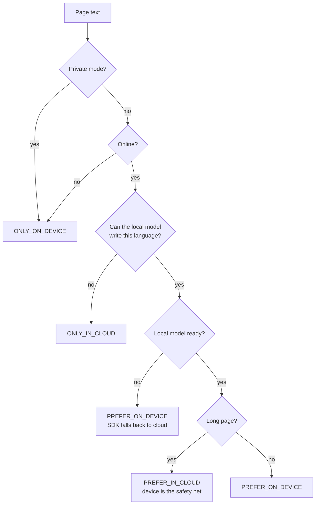

# PlainPage

**Make any page easy to read.** PlainPage rewrites dense text (contracts, medicine leaflets, government notices, articles) in plain language for people with dyslexia, low literacy, or a different first language.

It is a **hybrid AI** app built with the **Firebase AI Logic Hybrid Inference SDK**: it runs on Chrome's built-in on-device model when it can, and falls back to Gemini in the cloud when it must. It tells the reader which one it used, and why, every time.

**Try it live: https://plainpage-31699.web.app**

Built for the **#BuildHybridAI** hackathon. Platform: **Web (Chrome)**, shipped as a hosted web app and as a Chrome side-panel extension from one codebase.

---

## The problem

The documents people most need to understand are the hardest to read: a rental agreement, a medicine leaflet, a letter from the bank, a notice from the council. They are written far above the reading level of many of the people they affect. Dyslexia alone is commonly estimated to affect around 1 in 10 people, and many more read in a second language.

AI can rewrite these in plain language, but the usual tools send everything to a server. That is a poor fit here, because these are exactly the documents people would rather keep private.

## What PlainPage does

- **Rewrites text at three reading levels** (Easy, Plain, Clear), keeping every fact, number, date and warning.
- **"In short"**: the three most important points, at the top.
- **"Words to know"**: difficult terms from the page with simple meanings (structured JSON output).
- **Explain any word**: select a word or phrase in the text to get it explained in context.
- **Reading-level meter**: shows the change, for example "Grade 14 to Grade 8", measured locally with the Flesch-Kincaid formula.
- **Reading comfort**: dyslexia-friendly fonts (Atkinson Hyperlegible, Lexend, OpenDyslexic), text size, line and letter spacing, tinted backgrounds, a reading ruler, and read-aloud with the block being read highlighted.
- **Compare view**: original and plain text side by side.
- **12 output languages**, including Hindi, Tamil, Telugu and Bengali.
- **Private mode**: a switch that guarantees the page never leaves the device.
- **Works offline** with the on-device model (the web app is an installable PWA).
- **Library**: save pages and build a personal word list, synced across devices.
- **Chrome extension**: one click on the toolbar button reads the page you are on.

## Why this needs hybrid inference

PlainPage does not just set `PREFER_ON_DEVICE` and hope. A small, tested router ([src/ai/router.ts](src/ai/router.ts)) picks one of the SDK's four inference modes for each job, and explains the choice to the reader before they press the button.

| Situation | Mode | Why |
| --- | --- | --- |
| Private mode is on | `ONLY_ON_DEVICE` | The page must never leave the device. If the device cannot do the job, PlainPage refuses instead of leaking. |
| Offline | `ONLY_ON_DEVICE` | The device is the only option. |
| Output language the local model cannot write (for example Tamil) | `ONLY_IN_CLOUD` | Gemini Nano writes a few languages; the cloud covers the rest. |
| No local model, or still downloading | `PREFER_ON_DEVICE` | The SDK falls back to the cloud by itself. |
| Long page | `PREFER_IN_CLOUD` | The cloud is much faster on long documents; the device is the safety net. |
| Everything else | `PREFER_ON_DEVICE` | Private, free, instant, works offline. |



On top of the SDK's own fallback, the engine ([src/ai/engine.ts](src/ai/engine.ts)) handles what the SDK leaves to the app:

- **Mid-page recovery, both directions.** If the local model fails on a section, that section is retried in the cloud. If the cloud runs out of quota or the network drops, the section is re-split to fit the local model and finished on the device.
- **Right-sized chunks.** The on-device model has a small context window, so it gets small pieces that stream in one by one. The cloud gets large pieces, two at a time.
- **An honest receipt.** Every section shows the source reported by the SDK (`response.inferenceSource`). The summary line "Nothing from this page left your device" is only shown when the cloud was never asked.

## How Firebase AI Logic is used

All inference goes through Firebase AI Logic. The one place models are created is [src/ai/models.ts](src/ai/models.ts):

```ts
import { getGenerativeModel, InferenceMode, InferenceSource, Schema } from 'firebase/ai';

const model = getGenerativeModel(ai, {
  mode: InferenceMode.PREFER_ON_DEVICE,            // chosen by the router
  inCloudParams: {
    model: 'gemini-3.5-flash-lite',                // from Remote Config
    systemInstruction: systemPrompt,
    generationConfig: { temperature: 0.3 },
  },
  onDeviceParams: {
    createOptions: {
      expectedOutputs: [{ type: 'text', languages: ['en'] }],
      initialPrompts: [{ role: 'system', content: [{ type: 'text', value: systemPrompt }] }],
    },
  },
});

const result = await model.generateContentStream(prompt);
for await (const chunk of result.stream) {
  chunk.text();                                    // streamed to the reader
  chunk.inferenceSource === InferenceSource.ON_DEVICE; // shown as a badge
}
```

Features of the hybrid SDK in use:

- All four `InferenceMode` values, chosen per job by the router.
- `generateContentStream` for sections, the summary and word explanations.
- `generateContent` with **structured output** for "Words to know": the same `Schema` is passed as `responseSchema` (cloud) and `responseConstraint` (on-device).
- `inferenceSource` on every response, shown to the reader.
- `initializeDeviceModel()` with a progress callback for the one-time model download.

### Other Firebase products

| Product | What it does here | File |
| --- | --- | --- |
| **Firebase AI Logic** | All AI, on-device and cloud | [src/ai/models.ts](src/ai/models.ts) |
| **App Check** | Protects the Gemini API: reCAPTCHA v3 on the hosted site, debug token on localhost and in the extension | [src/firebase/app.ts](src/firebase/app.ts) |
| **Remote Config** | Tunes the router with no release: cloud model name, length threshold, chunk sizes, on-device languages, prompt guidance | [src/firebase/remoteConfig.ts](src/firebase/remoteConfig.ts) |
| **Authentication** | Anonymous account by default (zero sign-up), upgradeable to Google to sync | [src/firebase/store.ts](src/firebase/store.ts) |
| **Cloud Firestore** | Reading preferences, saved pages, personal word list, with offline cache | [src/firebase/store.ts](src/firebase/store.ts), [firestore.rules](firestore.rules) |
| **Hosting** | Serves the web app | [firebase.json](firebase.json) |

## Cost: zero

Everything runs on free tiers. No credit card is needed at any step.

| Item | Cost |
| --- | --- |
| On-device inference (Gemini Nano in Chrome) | Free |
| Cloud inference: Gemini Developer API free tier, `gemini-3.5-flash-lite` (a no-billing model) | Free within limits |
| Firebase Spark plan: Hosting, Firestore, Authentication, Remote Config, App Check | Free within limits |
| reCAPTCHA v3 site key for App Check | Free |
| Read-aloud: the browser's built-in speech | Free |
| Fonts: bundled, SIL Open Font License | Free |
| Chrome extension: loaded unpacked from this repo (no Chrome Web Store fee) | Free |

On the Spark plan, going over a free limit pauses the service until the limit resets. It never creates a charge. Do not link a billing account and it stays that way.

---

## Quick start

Requirements: Node.js 22 or newer, and Chrome on a desktop computer.

```bash
npm install
```

```bash
cp .env.example .env.local
```

Fill in `.env.local` using the Firebase setup below, then:

```bash
npm run dev
```

Open http://localhost:5173.

**No Firebase project yet?** You can still see the whole interface with a stand-in model: run `npm run dev` and open http://localhost:5173/?mock. This development harness swaps Chrome's model for a rule-based fake, so the output is not real AI. It is compiled out of production builds.

## Firebase setup (about 10 minutes, free)

1. **Create a project** at https://console.firebase.google.com. Google Analytics is not needed. Stay on the Spark plan.
2. **Turn on Firebase AI Logic**: Build > AI Logic > Get started, and choose the **Gemini Developer API**. This is the free option.
3. **Register a web app**: Project settings > Your apps > Web. Copy the `firebaseConfig` values into `.env.local`.
4. **Authentication**: Build > Authentication > Sign-in method, enable **Anonymous**. Enable **Google** as well if you want sync across devices.
5. **Firestore**: Build > Firestore Database > Create database, in production mode.
6. **App Check**
   - Hosted site: create a free **reCAPTCHA v3** key at https://www.google.com/recaptcha/admin for your `PROJECT_ID.web.app` domain. In Firebase, App Check > Apps > your web app > reCAPTCHA, paste the *secret* key. Put the *site* key in `.env.local` as `VITE_RECAPTCHA_SITE_KEY`.
   - Localhost: generate a UUID (`uuidgen`), put it in a new file `.env.development.local` as `VITE_APPCHECK_DEBUG_TOKEN=<uuid>`, and register it under App Check > Apps > Manage debug tokens.
   - Then enforce it: App Check > APIs > Firebase AI Logic > Enforce.
7. **Deploy** rules, Remote Config and the site:

```bash
npx firebase-tools login
```

```bash
npx firebase-tools use --add
```

```bash
npm run deploy
```

Keep debug tokens out of `.env.local`: that file is used for the hosted build. `.env.development.local` and `.env.extension.local` are only read by the dev server and the extension build, and none of the `.env.*local` files are committed.

## Turn on the on-device model in Chrome

1. Use Chrome 139 or newer on a desktop computer.
2. Open `chrome://flags/#prompt-api-for-gemini-nano-multimodal-input`, set it to **Enabled**, and restart Chrome.
3. In PlainPage, click the status chip in the top bar and press **Download on-device model**. The download is a one-time step and takes a few minutes.

Until the model is ready, PlainPage uses the cloud. That is the hybrid fallback working.

## The Chrome extension

Create `.env.extension.local` with an App Check debug token (extensions cannot load the reCAPTCHA script under Manifest V3):

```bash
echo "VITE_APPCHECK_DEBUG_TOKEN=$(uuidgen)" > .env.extension.local
```

Register that token in Firebase (App Check > Apps > Manage debug tokens), then build:

```bash
npm run build:extension
```

In Chrome, open `chrome://extensions`, turn on **Developer mode**, press **Load unpacked** and choose the `dist/extension` folder.

- Click the PlainPage toolbar button on any page: the side panel opens with that page loaded.
- Or select text, right-click, and choose **Make this plain with PlainPage**.

The extension asks for the narrowest permission that works. A click grants access to that page only (`activeTab`); wider access is opt-in from the panel.

## Scripts

| Command | What it does |
| --- | --- |
| `npm run dev` | Dev server for the web app |
| `npm test` | Unit tests for the router, chunker, engine fallback and readability meter |
| `npm run typecheck` | TypeScript check |
| `npm run build` | Web app to `dist/web` |
| `npm run build:extension` | Extension to `dist/extension` |
| `npm run deploy` | Build and deploy Hosting, Firestore rules and Remote Config |

## Project layout

```
src/
  ai/
    router.ts        Picks the inference mode for each job (pure, tested)
    chunker.ts       Splits pages to fit each model (pure, tested)
    engine.ts        The pipeline: sections, summary, words, fallback both ways (tested with fakes)
    models.ts        Firebase AI Logic hybrid models: the only place models are created
    prompts.ts       Prompts shared by both models
    device.ts        Reads the on-device model's status for the UI
  firebase/
    app.ts           Firebase app, App Check, AI Logic service
    remoteConfig.ts  Remote Config to RuntimeConfig
    store.ts         Authentication and Firestore
  components/        Top bar, compose screen, reader, panels, explain popover
  lib/               Page extraction, readability meter, read-aloud, preferences, rendering
  dev/               Development-only stand-in for the on-device model
extension/           Manifest V3 manifest and service worker
public/              PWA manifest, service worker, icons
firestore.rules      Per-user security rules
remoteconfig.template.json   Router settings, deployable
```

## Remote Config parameters

| Key | Default | Purpose |
| --- | --- | --- |
| `cloud_model` | `gemini-3.5-flash-lite` | Cloud model for fallback and long pages |
| `device_max_chars` | `14000` | Pages longer than this go to the cloud |
| `device_chunk_chars` | `2800` | Piece size for the on-device model |
| `cloud_chunk_chars` | `20000` | Piece size for the cloud model |
| `device_languages` | `en,es,ja` | Languages the on-device model can write |
| `words_enabled` | `true` | Show "Words to know" |
| `style_guidance` | *(empty)* | Extra rule appended to the rewrite prompt |

When Chrome ships a larger on-device model or a new language, changing these values moves more work onto the device with no new release.

## Privacy

- In Private mode, PlainPage only ever calls the on-device model. Saving to the library is turned off for that page.
- Outside Private mode, the banner above the button says where the text will go before anything is sent.
- Saved pages and words are stored under your own account in Firestore and are readable only by you ([firestore.rules](firestore.rules)).
- The extension reads a page only when you ask it to.

## License

[Apache License 2.0](LICENSE). Bundled fonts are under the SIL Open Font License 1.1.
